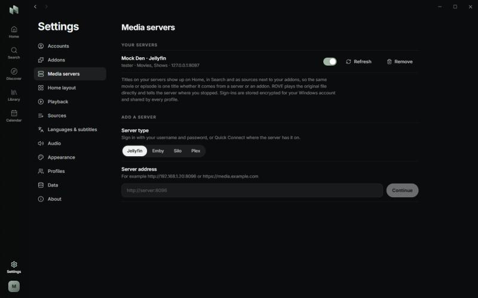
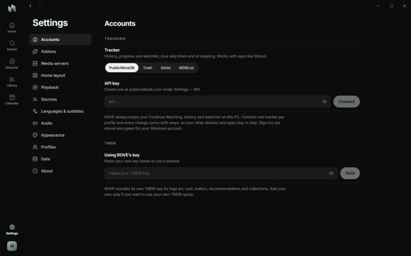
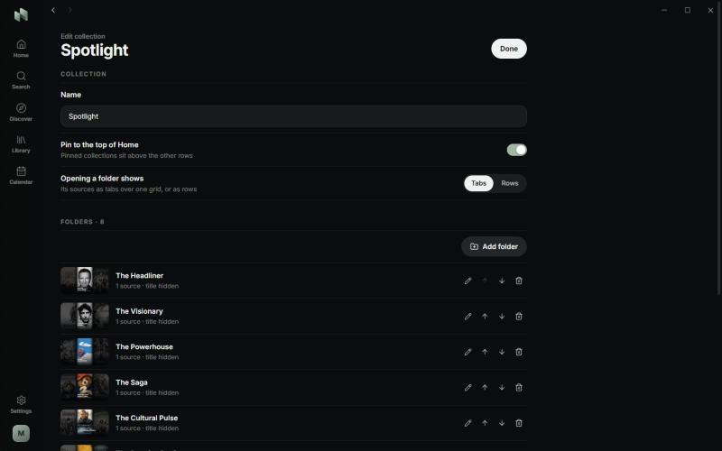
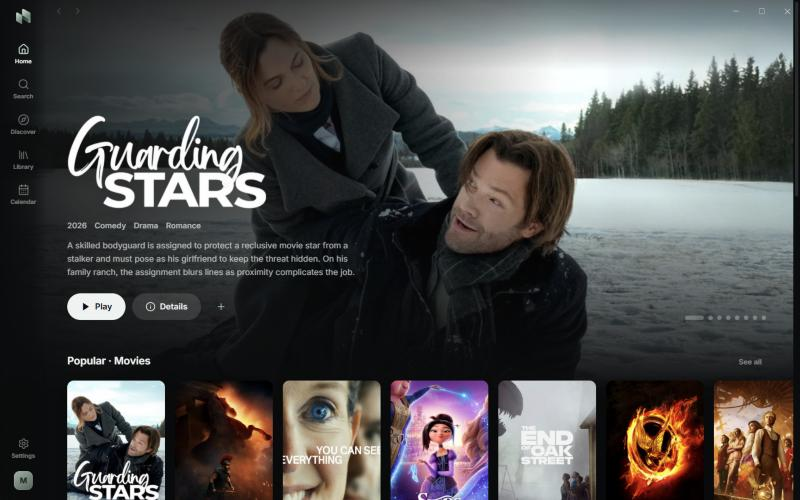
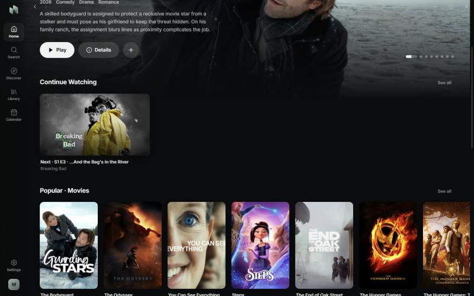
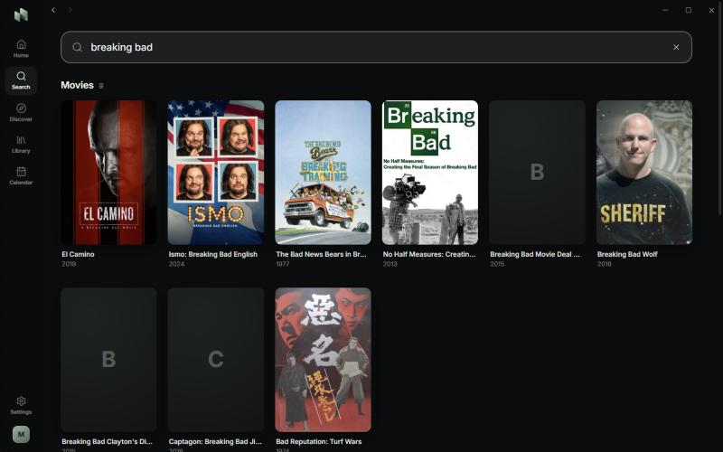
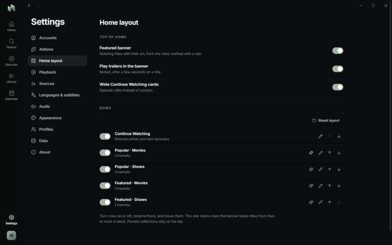

# Changelog

All notable changes to ROVE. Dates are when the change was made. Screenshots live in
`docs/screenshots/` and are linked from the entry that introduced the screen.

## Unreleased

### 2026-11-24 — Media servers, tracker choice, collections for everyone, smooth scrolling

| Media servers | Accounts |
|---|---|
|  |  |
|  |  |

**Added**
- Media servers (Settings → Media servers): Jellyfin, Emby, Silo (which speaks Jellyfin's API)
  and Plex. Jellyfin, Emby and Silo sign in with a username and password, or Quick Connect where
  the server has it on; Plex signs in through plex.tv in the browser and lists the account's
  servers, and ROVE picks the address that answers (local first, relay last).
- Each server adds rows to Home (Continue on, Recently added, one per library), results to
  Search (listed first), and its own copy as a source next to addon sources, marked "Your
  server". Titles the server knows by IMDb id are the same title as from addons: one page, one
  Continue Watching entry, one tracker history. Titles only on the server open from the server.
- Playback from a server is direct play of the original file, and the server is told about
  start, progress, pause and stop, so its own resume points and watched marks stay right.
- Tracker choice per profile (Settings → Accounts): PublicMetaDB, Trakt, Simkl or MDBList.
  Trakt and Simkl sign in with a short code shown in ROVE and approved in the browser (Simkl's
  newer device sign-in, falling back to its PIN sign-in); MDBList and PublicMetaDB use an API
  key. Every tracker syncs resume points, watched history and the watchlist both ways; Trakt
  rewatches are respected, and tokens renew themselves. Continue Watching is always kept on this
  PC whether or not a tracker is connected.
- Resume points that a tracker only knows as a percentage start at that share of the video and
  do not show minutes left.
- Backups include tracker sign-ins and media servers when keys are included.
- Every new profile starts with the bundled collection set (streaming services, networks,
  genres, moods, studios, decades and more), so Home is full without importing anything.
- The banner takes titles from the first collection when no catalog row feeds it, and uses
  textless backdrops.
- Edit collections and their folders from Home and the Library: rename, reorder, cover art,
  sources, and a right-click menu on every folder.
- ROVE has its own TMDB key built in; a personal key in Settings → Accounts still wins.

**Fixed**
- Scrolling Home was slow. Cards no longer each carry a shadow and animation, off-screen rows
  and cards skip layout and paint, and the banner no longer pans its image. Measured in the real
  window on a copy of a full Home (19 rows): before, 70.8 fps with frames up to 133 ms; after,
  74.8 fps on a 75 Hz screen with one slow frame (27 ms).
- A catalog source that ignores paging (returning the same titles for every page) made rows and
  "See all" keep asking for more forever. A page with nothing new now ends the list.

**Checked**
- Unit tests for the Trakt, Simkl and MDBList mappings and request bodies, and for the
  Jellyfin, Emby and Plex adapters (ids, image and file links, headers, play reports).
- In the running interface against a stand-in Jellyfin server: sign-in, Home rows, Search, a
  server-only show's page and episodes, and the source list. Not yet checked against real
  Jellyfin, Emby, Silo or Plex servers, or real Trakt, Simkl and MDBList accounts.
- Trakt and Simkl sign-in need ROVE's app ids at build time (`VITE_TRAKT_CLIENT_ID`,
  `VITE_TRAKT_CLIENT_SECRET`, `VITE_SIMKL_CLIENT_ID`); without them the screen says the build
  does not include that tracker.

### 2026-11-24 — Window, Home and profile fixes

**Fixed**
- The window could not be moved. The page runs in WebView2's own process, which holds the mouse
  while the button is down, so the system's move could not start from ROVE's side. The title bar
  now uses WebView2's title-bar regions: drag, Snap, double-click to maximize and the window menu
  all behave like any Windows app. The splash, profile picker and first-run setup now have the
  title bar too. Resizing from the top edge follows the mouse directly for the same reason.
  Checked by a scripted mouse drag on the debug and the packaged build.
- The background glitched while resizing: the window now paints ROVE's background, no longer
  paints over the video and page windows, and animations and blur pause during the resize.
- Collection folders whose TMDB source says `MOVIE`/`TV` in capitals loaded TV lists as movies.

**Added**
- Profile photos: upload an image in Settings → Profiles; it is centre-cropped and shown in the
  picker, the sidebar and everywhere else.
- Home explains collection-based setups (a metadata addon that keeps its catalogs off Home) and
  offers Import collection and Discover right there.
- Continue Watching cards show the title, then the episode and time left.
- Trakt list folders say they need Trakt (coming) instead of showing an empty grid.

### 2026-11-24 — The full app

The prototype player became the whole app. Every screen below was checked in the running
interface; the [feature checklist](FEATURES.md) marks what is not yet checked against real stream
addons and accounts.

| Home | Show |
|---|---|
|  |  |
|  |  |
|  |  |
|  |  |

**Added**
- Home: featured banner with logo art and optional trailers, Continue Watching with next episodes,
  a row per catalog loading as it scrolls, collection rows, and a layout editor.
- Title pages for movies and shows: logo art, ratings, age rating, season tabs, episode cards
  with watched ticks and progress, cast, More like this, details, trailer, right-click menus.
- Discover with catalog picker and genre chips; Search across every catalog with recent searches;
  Library (Watchlist, Continue Watching, History, Collections); Calendar; person pages.
- Source picker that fills in as addons answer, with quality badges and filters; auto-play by
  binge group, first source or regex; reuse of a recent working link; external players.
- Player: next-episode card with countdown, "Are you still watching?", skip intro/recap/credits,
  episode list, source switching, picture/speed/audio/subtitle menus, subtitle styling, subtitles
  from subtitle addons, per-show audio and subtitle memory, keyboard help, wheel volume, error
  screen with Retry and Try another source, picture in picture, Windows media controls.
- PublicMetaDB sync, watchlist mirroring, profiles with PINs and kids mode, accent colours.
- Back up and restore for moving to another PC (addons, profiles, settings; keys optional).
- Settings for accounts, addons, Home layout, playback, sources, languages and subtitles, audio,
  appearance, profiles, data and about.
- Safe close: the window asks the page to save everything before the app exits.

**Fixed**
- Two screens asking for the same data shared one request; when the first gave up it failed the
  other too (title pages could show "could not be loaded"). Shared requests are never cancelled
  now; each caller only stops waiting.
- Updating a screen's address (for example the search text) rebuilt the screen each time, so it
  kept fading in. Screens now update in place.
- Messages from the shell reached only the last listener, so the player could stop hearing
  position updates once another part of the page listened. Every listener gets every message now.
- Streams were sent with an empty user agent, which some hosts refuse (HTTP 400).
- Inactive banner slides could take keyboard focus.

**Removed**
- The Nuvio import. ROVE is for anyone; moving between PCs uses ROVE's own backup.

**Tests**: 28 interface unit tests, 2 shell tests; native playback checked with the debug and the
packaged release build.

### 2026-11-24 — Foundation, player and data layer

**App shell (Rust)**
- Frameless window with a ROVE title bar, snapping, resizing from every edge, maximize and
  borderless fullscreen; one running copy (a second launch brings the window forward).
- mpv draws the video with Direct3D 11 (gpu-next, hardware decoding) in a child window beneath a
  transparent WebView2 page, the pattern Stremio's and AIOStreams' Windows apps use.
- Local service for the page under `rove.localhost/__api`: HTTP requests without CORS limits,
  JSON documents in the data folder, and secrets (addon links, API keys) encrypted with Windows
  DPAPI for the signed-in user.
- Import from Nuvio: addon links, collections, home layout, TMDB key, player preferences,
  per-show track choices and search history (never the PublicMetaDB key).
- Picture in picture: a small always-on-top window in the screen corner; restores exactly.
- Window size, position and maximized state remembered between starts.
- Player command allow-list: only web links can be played, only known properties set, audio
  filters limited to fixed presets; external players launch only a chosen `.exe` with the link.
- Screenshots save to `Pictures\ROVE`.
- Log file at `%LOCALAPPDATA%\ROVE\logs\rove.log`, including mpv warnings and errors.

**Bluetooth and audio**
- Audio returns after the output device drops (Bluetooth headphones reconnecting): mpv falls back
  to a silent output so the picture keeps playing, then ROVE reopens the real output when the
  device list changes or on a 5/10/20/30 s backoff. Verified: no stall and no re-buffer through a
  simulated 10 s outage. Not yet verified on a real headset.
- Audio offset setting for Bluetooth latency (−500 to +1500 ms), remembered.

**Addons and data**
- Stremio addon protocol: manifests, catalogs (with genre and paging), metadata, streams and
  subtitles; routing by resource, type and id prefix, falling through on empty answers;
  `cacheMaxAge` honoured; in-flight requests de-duplicated; retries with backoff.
- TMDB: logos, cast, recommendations, certifications, trailers, IMDb↔TMDB mapping; TMDB
  collection sources (lists, collections, companies, networks, discover, people).
- PublicMetaDB: two-way sync of resume points, watched history and the watchlist; progress saved
  on pause and stop and every 5 minutes; watched at 90 %; nothing saved under 2 %; changes queue
  in an outbox and retry with backoff; timestamps in all PMDB formats parsed.
- Continue Watching: resume points plus the next aired episode after the latest finished one,
  one card per title, newest first; removing a title hides it until there is new activity.
- Source choice keeps each addon's own order (AIOStreams sorts server-side), skips rows without a
  link, follows the previous episode's binge group, then the auto-play rule (first, binge, regex).
- Skip segments from chapter names, TheIntroDB, IntroDB, PublicMetaDB and AniSkip, best source
  per segment, implausible timestamps dropped.
- Track choice per show (remembered), then preferred languages; subtitle modes off / forced only /
  when the audio is in another language / always; SDH last when asked.

**Tests**
- 32 unit tests (ids, PublicMetaDB parsing, Continue Watching, stream choice, skip segments,
  track choice) and 2 shell tests (DPAPI round trip, Nuvio settings parsing).
