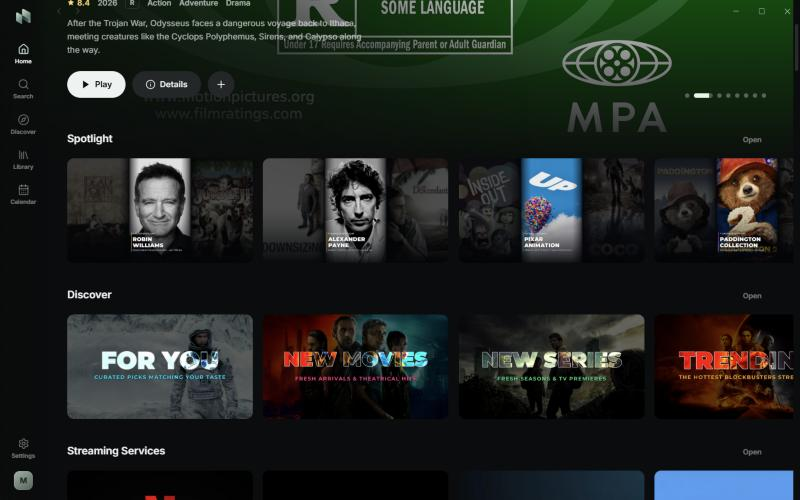
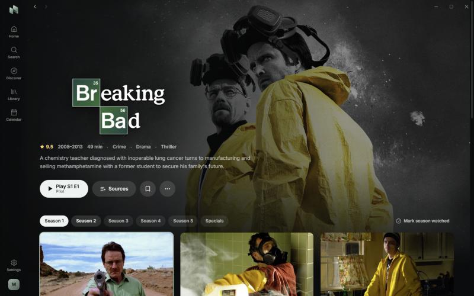
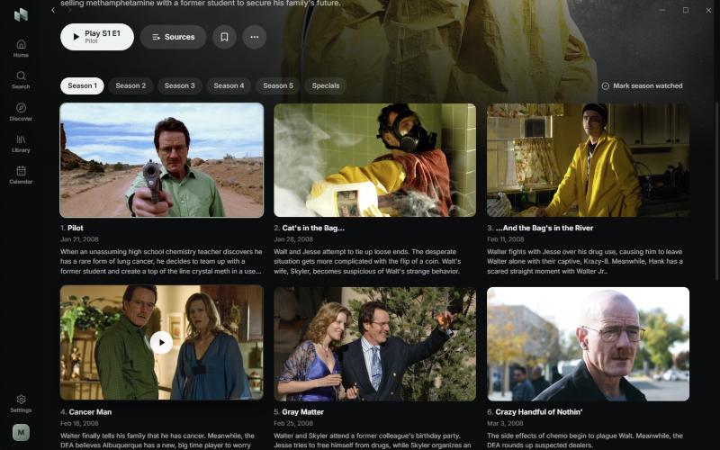
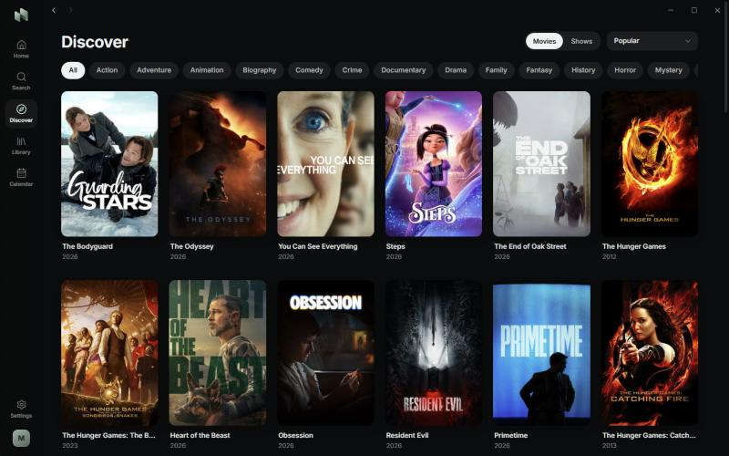
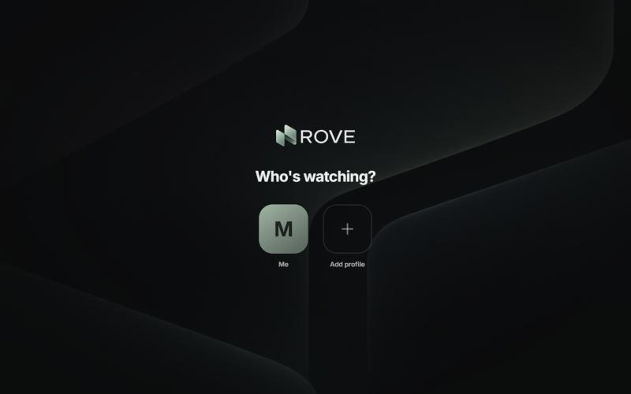

# Changelog

All notable changes to ROVE. Dates are when the change was made. Screenshots live in
`docs/screenshots/` and are linked from the entry that introduced the screen.

## Unreleased

## 0.2.1 — 2026-11-25

**Fixed**
- Updating from inside the app did not install: the installer tried to restart itself quietly
  and Windows refused. An update now runs the installer in plain view with every question
  answered for you: a short progress window, then ROVE reopens.
- The player's More menu is wide enough for its labels.

**Checked**
- An installed 0.2.0 on a test data folder found this release, downloaded and verified it,
  installed it and reopened as 0.2.1.

## 0.2.0 — 2026-11-25

The first release that updates itself. Everything under "Audit and repair" below is part of it.

### Discovery, lists, assistant, updates

**Added**
- **Rows made for you.** Home builds streaming-service style rows from your own history, with no
  account and no key to enter: Top picks for you, Because you watched …, Trending this week,
  numbered Top 10 movies and shows, New releases you might like, rows for your strongest genres,
  Hidden gems and From your watchlist. Titles you have watched, are watching or marked "Not
  interested" are left out, and one title does not repeat across rows. One switch in Settings →
  Home layout turns them all off.
- **Lists from Trakt, MDBList and your media servers.** "Import lists" (Library → Collections,
  Settings → Home layout, and inside a collection's editor) adds your lists, liked, popular and
  searched lists, or a pasted link, as rows on Home or as folders in a collection. Server
  collections and playlists count as lists.
- **The built-in Home's Trakt folders work.** Kaptain's Collection ships with 326 Trakt-list
  folders that could not load before; they do now. Folders and collections an earlier build
  removed for that reason are put back once, without touching anything you made.
- **AI assistant** (Settings → Accounts) with your own key: Claude, Gemini, or any
  OpenAI-compatible service. "Ask" in Search takes a request in plain words and shows real
  titles with a one-line reason each; a "For you" row on Home refreshes at most once a day.
  Nothing is sent unless you connect one.
- **Update button.** ROVE looks for a newer release at start and in Settings → About; updating
  downloads the Setup, checks it against the release signature, installs and reopens ROVE.
- **Banner like a streaming service's.** A title's trailer fades in over its art, the description
  steps aside and the logo shrinks while it plays, and the banner moves on when it ends. It can
  start by itself or only under the pointer, has a sound button (quiet by default), and never
  shows YouTube's own controls. Settings → Home layout also chooses what the banner features:
  the rows, Continue Watching, or your watchlist.
- **Home takes its colour from the banner**, carried down the page and into the navigation bar.
- **Navigation on the left or across the top** (Settings → Appearance).
- **Player:** button names show at once on hover; Speed, Picture, Picture in picture, Playback
  info and Keyboard shortcuts moved into one More menu; the episode list has a season picker,
  opens on the episode that is playing and shows each episode's description. The title page uses
  the same season picker when a show has more than six seasons.

**Fixed**
- Side panels (episodes, sources) could not be scrolled: the panel grew taller than the window.
- Trakt sign-in follows Trakt's current system (its sign-in host, no app secret).
- Backups include the assistant and MDBList keys when keys are included.

**Changed**
- One version number for the app, the page and the installer (`shell/Cargo.toml`).
- The installer waits for ROVE to close during an update instead of giving up, and reopens it.
- GPL-3.0 licence, a privacy note (PRIVACY.md) and credits added.

**Checked**
- Typecheck; 316 unit tests in the page, 4 in the shell (including that an update with a wrong
  or missing signature is refused).
- A test copy of the built app on a copy of a real synced history: the made-for-you rows appear
  under Continue Watching in order; the banner's trailer plays and fades into the page colour
  with no edge; the navigation bar takes the colour; the player shows its picture with the
  shorter control bar and More menu. Windows Defender scans the build clean.
- In the browser build: list import with public Trakt lists read for real; MDBList with stand-in
  answers; the assistant's screens against a stand-in service; top navigation; the page colour.
- Trakt's sign-in host answered a device-code request made with ROVE's app id.
- Not checked: a real assistant key; Trakt, MDBList or media-server accounts; the update
  download and install against a published release (checked after this release exists).

**Note**
- An earlier form of the updater made Windows Defender's machine-learning check flag ROVE itself
  (it started the installer with "silent" switches, which reads as a dropper). The app now passes
  only an update marker and the installer makes itself quiet. Unsigned builds can still be
  flagged by such checks; code signing is the lasting answer.

### 2026-11-25 — Audit and repair

The whole app was read for defects and the findings were worked through. The lists, with the
state of every item, are in `docs/audit/` (player, tracking, and everything else): 96 fixed,
10 partly, 2 open.

**Fixed: playback**
- No picture during playback. The video window was cut out from under the page (sibling
  clipping), and the main window lost the style that keeps it from painting over its children
  each time it was shown, maximized or put in full screen. The style is now enforced on every
  change and the video window is no longer clipped.
- Play no longer waits for the slowest stream addon: it starts once no unanswered addon could
  change the choice, or a few seconds after the first answer.
- A film or last episode that reaches its end is marked watched and the player closes; with a
  next episode it starts (auto-play and "still watching" respected). The Up Next card retracts
  when you seek back.
- The exact position is saved (and queued for the tracker) on every way out of a video:
  episode change, source change, leaving the player, closing the window. A media server gets its
  stop report.
- A link is remembered only after it has actually played; a failed one is forgotten, and the
  "finding a fresh source" loop is gone. Position survives a failed or slow source switch.
- Picture mode, zoom, subtitle delay and speed no longer leak into the next video. Shortcuts keep
  working after using the volume slider, with Caps Lock on, and are off under dialogs.
- Picture in picture: the small window drags by its picture, ignores full screen, and returns to
  the size and state it came from. External player: ROVE pauses and says whether it opened.

**Fixed: Continue Watching and tracking**
- Continue Watching was missing from Home when collections were pinned (they were forced above
  every row). Home now follows the order in Settings → Home layout exactly.
- One id per title. History pulled from a tracker was stored under `tmdb:` ids because a failed
  id lookup was remembered forever; "next episode" cards, names, art and the title page's ticks
  and Resume button then did not line up. Lookups are retried, existing entries move to the
  IMDb id once it is known (nothing is dropped when it is not), and metadata and sources fall
  back to the other id form.
- Sync no longer deletes a resume point that is newer here than on the tracker, no longer treats
  a failed or partial download as "removed elsewhere", keeps unsent changes if the app closes
  mid-send, and cannot write one profile's data into another during a profile switch.
- "Watched" is sent once per viewing instead of every few seconds through the credits. Bulk
  marks skip episodes already watched. Watchlist changes queue and sync both ways.
- Poster-style Continue Watching cards play on click and have Remove and Mark watched.

**Fixed: Home, browsing, settings**
- Back and forward arrows are hidden on Home and wherever neither goes anywhere. Sidebar tabs
  return to the screen you left instead of stacking copies.
- Banner trailers play only while the pointer rests on the banner, and page media no longer
  appears in the Windows media overlay or takes the media keys.
- Long dropdowns scroll; Escape in a dropdown no longer closes the dialog around it; window
  buttons work while a dialog is open.
- A failing addon shows an error with Try again instead of empty content or minutes of
  placeholders; a failed "load more" keeps what was loaded.
- Default collections: sources ROVE cannot show are removed at seed, import and once for
  collections already saved. The folder editor has a genre picker; "Add folder" then Cancel
  leaves nothing behind; tile shape applies per tile.
- Deleting a profile and restoring a backup ask first; a PIN-protected profile needs its PIN to
  be edited; undo for a removed addon or server restores it as it was.
- A saved file that exists but cannot be read is no longer replaced by an empty one.

**Added**
- A ⋯ menu on every Home row (also on right-click of its header): Move up, Move down, Hide from
  Home, Edit folders, Home layout. Settings → Home layout has an Edit folders button per
  collection.
- Scroll bars are hidden everywhere.

**Checked**
- Typecheck; 120 unit tests.
- Packaged build in a test copy with its own data folder: a sample clip shows its picture with
  the controls on top in windowed, maximized and full screen (the app's own window area
  captured); at the end of the clip the player closes back to Home.
- A copy of a real PublicMetaDB-synced history (28 resume points, 649 watched): all entries kept,
  positions unchanged, 637 watched entries moved to IMDb ids, 12 with no match left as they were.
- Browser build with the same history and Cinemeta: Continue Watching shows names, art and
  "Next" cards.
- Not checked: a real session with stream addons and a tracker account (sign-ins are not copied
  into test copies), real media servers, subtitle shadow style, Plex address recovery.

### 2026-11-24 — Windows installer

**Added**
- `ROVE-Setup-<version>.exe` (about 36 MB), built by `tools\make-installer.ps1` with Inno Setup.
  Installs for the current Windows account without an administrator prompt, adds Start menu and
  optional desktop shortcuts, registers an uninstaller in Settings → Apps, and checks for
  WebView2 first. Installing over an existing copy updates it in place; your data in
  `%LOCALAPPDATA%\ROVE` is kept, and uninstalling asks before removing it.
- ROVE holds a named lock while it runs so Setup can tell it is open and ask you to close it
  instead of replacing files in use.

**Checked**
- Silent install into a test folder: files, Start menu entry and Apps entry created; the
  installed copy opened and played a sample stream. Silent uninstall removed the files, the
  shortcut and the Apps entry and left the ROVE data folder untouched.
- Installing over a running ROVE in silent mode stops with an error rather than replacing files
  in use; the interactive Setup shows Inno Setup's "close ROVE first" prompt instead (not
  clicked through here).
- Not signed: Windows SmartScreen warns on first run.

### 2026-11-24 — Media servers, tracker choice, collections for everyone, smooth scrolling

| Media servers | Accounts |
|---|---|
|  |  |
|  |  |

**Added**
- Media servers (Settings → Media servers): Jellyfin, Emby, Silo (which speaks Jellyfin's API)
  and Plex. Jellyfin, Emby and Silo sign in with a username and password, or Quick Connect where
  the server has it on; Plex signs in through plex.tv in the browser and lists the account's
  servers, and ROVE picks the address that answers (local first, relay last).
- Each server adds rows to Home (Continue on, Recently added, one per library), results to
  Search (listed first), and its own copy as a source next to addon sources, marked "Your
  server". Titles the server knows by IMDb id are the same title as from addons: one page, one
  Continue Watching entry, one tracker history. Titles only on the server open from the server.
- Playback from a server is direct play of the original file, and the server is told about
  start, progress, pause and stop, so its own resume points and watched marks stay right.
- Tracker choice per profile (Settings → Accounts): PublicMetaDB, Trakt, Simkl or MDBList.
  Trakt and Simkl sign in with a short code shown in ROVE and approved in the browser (Simkl's
  newer device sign-in, falling back to its PIN sign-in); MDBList and PublicMetaDB use an API
  key. Every tracker syncs resume points, watched history and the watchlist both ways; Trakt
  rewatches are respected, and tokens renew themselves. Continue Watching is always kept on this
  PC whether or not a tracker is connected.
- Resume points that a tracker only knows as a percentage start at that share of the video and
  do not show minutes left.
- Backups include tracker sign-ins and media servers when keys are included.
- Every new profile starts with the bundled collection set (streaming services, networks,
  genres, moods, studios, decades and more), so Home is full without importing anything.
- The banner takes titles from the first collection when no catalog row feeds it, and uses
  textless backdrops.
- Edit collections and their folders from Home and the Library: rename, reorder, cover art,
  sources, and a right-click menu on every folder.
- ROVE has its own TMDB key built in; a personal key in Settings → Accounts still wins.

**Fixed**
- Scrolling Home was slow. Cards no longer each carry a shadow and animation, off-screen rows
  and cards skip layout and paint, and the banner no longer pans its image. Measured in the real
  window on a copy of a full Home (19 rows): before, 70.8 fps with frames up to 133 ms; after,
  74.8 fps on a 75 Hz screen with one slow frame (27 ms).
- A catalog source that ignores paging (returning the same titles for every page) made rows and
  "See all" keep asking for more forever. A page with nothing new now ends the list.

**Checked**
- Unit tests for the Trakt, Simkl and MDBList mappings and request bodies, and for the
  Jellyfin, Emby and Plex adapters (ids, image and file links, headers, play reports).
- In the running interface against a stand-in Jellyfin server: sign-in, Home rows, Search, a
  server-only show's page and episodes, and the source list. Not yet checked against real
  Jellyfin, Emby, Silo or Plex servers, or real Trakt, Simkl and MDBList accounts.
- Trakt and Simkl sign-in need ROVE's app ids at build time (`VITE_TRAKT_CLIENT_ID`,
  `VITE_TRAKT_CLIENT_SECRET`, `VITE_SIMKL_CLIENT_ID`); without them the screen says the build
  does not include that tracker.

### 2026-11-24 — Window, Home and profile fixes

**Fixed**
- The window could not be moved. The page runs in WebView2's own process, which holds the mouse
  while the button is down, so the system's move could not start from ROVE's side. The title bar
  now uses WebView2's title-bar regions: drag, Snap, double-click to maximize and the window menu
  all behave like any Windows app. The splash, profile picker and first-run setup now have the
  title bar too. Resizing from the top edge follows the mouse directly for the same reason.
  Checked by a scripted mouse drag on the debug and the packaged build.
- The background glitched while resizing: the window now paints ROVE's background, no longer
  paints over the video and page windows, and animations and blur pause during the resize.
- Collection folders whose TMDB source says `MOVIE`/`TV` in capitals loaded TV lists as movies.

**Added**
- Profile photos: upload an image in Settings → Profiles; it is centre-cropped and shown in the
  picker, the sidebar and everywhere else.
- Home explains collection-based setups (a metadata addon that keeps its catalogs off Home) and
  offers Import collection and Discover right there.
- Continue Watching cards show the title, then the episode and time left.
- Trakt list folders say they need Trakt (coming) instead of showing an empty grid.

### 2026-11-24 — The full app

The prototype player became the whole app. Every screen below was checked in the running
interface; the [feature checklist](FEATURES.md) marks what is not yet checked against real stream
addons and accounts.

| Home | Show |
|---|---|
|  |  |
|  |  |
|  |  |
|  |  |

**Added**
- Home: featured banner with logo art and optional trailers, Continue Watching with next episodes,
  a row per catalog loading as it scrolls, collection rows, and a layout editor.
- Title pages for movies and shows: logo art, ratings, age rating, season tabs, episode cards
  with watched ticks and progress, cast, More like this, details, trailer, right-click menus.
- Discover with catalog picker and genre chips; Search across every catalog with recent searches;
  Library (Watchlist, Continue Watching, History, Collections); Calendar; person pages.
- Source picker that fills in as addons answer, with quality badges and filters; auto-play by
  binge group, first source or regex; reuse of a recent working link; external players.
- Player: next-episode card with countdown, "Are you still watching?", skip intro/recap/credits,
  episode list, source switching, picture/speed/audio/subtitle menus, subtitle styling, subtitles
  from subtitle addons, per-show audio and subtitle memory, keyboard help, wheel volume, error
  screen with Retry and Try another source, picture in picture, Windows media controls.
- PublicMetaDB sync, watchlist mirroring, profiles with PINs and kids mode, accent colours.
- Back up and restore for moving to another PC (addons, profiles, settings; keys optional).
- Settings for accounts, addons, Home layout, playback, sources, languages and subtitles, audio,
  appearance, profiles, data and about.
- Safe close: the window asks the page to save everything before the app exits.

**Fixed**
- Two screens asking for the same data shared one request; when the first gave up it failed the
  other too (title pages could show "could not be loaded"). Shared requests are never cancelled
  now; each caller only stops waiting.
- Updating a screen's address (for example the search text) rebuilt the screen each time, so it
  kept fading in. Screens now update in place.
- Messages from the shell reached only the last listener, so the player could stop hearing
  position updates once another part of the page listened. Every listener gets every message now.
- Streams were sent with an empty user agent, which some hosts refuse (HTTP 400).
- Inactive banner slides could take keyboard focus.

**Removed**
- The Nuvio import. ROVE is for anyone; moving between PCs uses ROVE's own backup.

**Tests**: 28 interface unit tests, 2 shell tests; native playback checked with the debug and the
packaged release build.

### 2026-11-24 — Foundation, player and data layer

**App shell (Rust)**
- Frameless window with a ROVE title bar, snapping, resizing from every edge, maximize and
  borderless fullscreen; one running copy (a second launch brings the window forward).
- mpv draws the video with Direct3D 11 (gpu-next, hardware decoding) in a child window beneath a
  transparent WebView2 page, the pattern Stremio's and AIOStreams' Windows apps use.
- Local service for the page under `rove.localhost/__api`: HTTP requests without CORS limits,
  JSON documents in the data folder, and secrets (addon links, API keys) encrypted with Windows
  DPAPI for the signed-in user.
- Import from Nuvio: addon links, collections, home layout, TMDB key, player preferences,
  per-show track choices and search history (never the PublicMetaDB key).
- Picture in picture: a small always-on-top window in the screen corner; restores exactly.
- Window size, position and maximized state remembered between starts.
- Player command allow-list: only web links can be played, only known properties set, audio
  filters limited to fixed presets; external players launch only a chosen `.exe` with the link.
- Screenshots save to `Pictures\ROVE`.
- Log file at `%LOCALAPPDATA%\ROVE\logs\rove.log`, including mpv warnings and errors.

**Bluetooth and audio**
- Audio returns after the output device drops (Bluetooth headphones reconnecting): mpv falls back
  to a silent output so the picture keeps playing, then ROVE reopens the real output when the
  device list changes or on a 5/10/20/30 s backoff. Verified: no stall and no re-buffer through a
  simulated 10 s outage. Not yet verified on a real headset.
- Audio offset setting for Bluetooth latency (−500 to +1500 ms), remembered.

**Addons and data**
- Stremio addon protocol: manifests, catalogs (with genre and paging), metadata, streams and
  subtitles; routing by resource, type and id prefix, falling through on empty answers;
  `cacheMaxAge` honoured; in-flight requests de-duplicated; retries with backoff.
- TMDB: logos, cast, recommendations, certifications, trailers, IMDb↔TMDB mapping; TMDB
  collection sources (lists, collections, companies, networks, discover, people).
- PublicMetaDB: two-way sync of resume points, watched history and the watchlist; progress saved
  on pause and stop and every 5 minutes; watched at 90 %; nothing saved under 2 %; changes queue
  in an outbox and retry with backoff; timestamps in all PMDB formats parsed.
- Continue Watching: resume points plus the next aired episode after the latest finished one,
  one card per title, newest first; removing a title hides it until there is new activity.
- Source choice keeps each addon's own order (AIOStreams sorts server-side), skips rows without a
  link, follows the previous episode's binge group, then the auto-play rule (first, binge, regex).
- Skip segments from chapter names, TheIntroDB, IntroDB, PublicMetaDB and AniSkip, best source
  per segment, implausible timestamps dropped.
- Track choice per show (remembered), then preferred languages; subtitle modes off / forced only /
  when the audio is in another language / always; SDH last when asked.

**Tests**
- 32 unit tests (ids, PublicMetaDB parsing, Continue Watching, stream choice, skip segments,
  track choice) and 2 shell tests (DPAPI round trip, Nuvio settings parsing).
