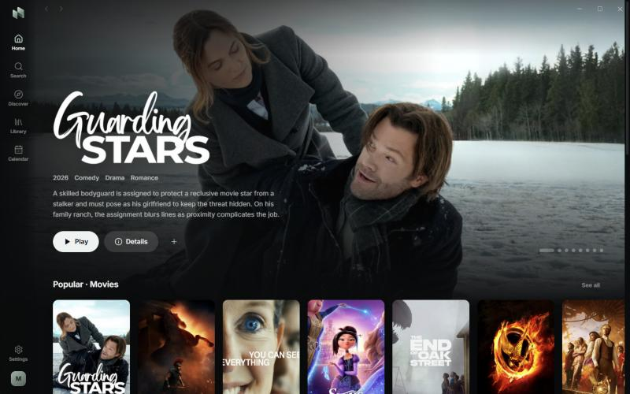

# ROVE

A streaming app for Windows that plays from the Stremio addons you choose (for example
AIOMetadata for catalogs and AIOStreams for sources) and keeps your history with PublicMetaDB.
Built to feel like a native, polished media app: smooth, quiet, and fast to start.



- What it does, and what is checked: [FEATURES.md](FEATURES.md)
- What changed, when: [CHANGELOG.md](CHANGELOG.md)

## Installing

Run `ROVE-Setup-<version>.exe`. It installs for your Windows account only (no administrator
prompt) into `%LOCALAPPDATA%\Programs\ROVE`, adds ROVE to the Start menu (and the desktop if you
tick it), and appears in Settings → Apps for uninstalling. Running a newer Setup over an
installed ROVE updates it and keeps everything you set up; close ROVE first.

The installer is not code-signed yet, so Windows SmartScreen shows "Windows protected your PC":
choose **More info → Run anyway**. ROVE needs Microsoft Edge WebView2, which Windows 11 and
current Windows 10 already have; Setup says so and opens Microsoft's download page if it is
missing.

Uninstalling asks whether to also remove your profiles, history, addons and sign-ins; by default
they are kept for a later install.

## How it is put together

```
┌──────────────────────── ROVE window (Rust: tao + wry) ────────────────────────┐
│  WebView2, transparent: the whole interface (React + TypeScript, ui/)          │
│      ▲ JSON messages (player commands, window actions, media keys)             │
│      │ local service at rove.localhost/__api (HTTP, encrypted storage)          │
│  child window: mpv draws the video with Direct3D 11 (gpu-next, libplacebo)     │
└────────────────────────────────────────────────────────────────────────────────┘
```

- `shell/` — the Rust app: window, mpv (loaded at runtime), the bridge, picture in picture,
  Windows media controls, DPAPI-encrypted secrets, save-before-close.
- `ui/` — the interface: addons (Stremio protocol), TMDB, PublicMetaDB sync, Continue Watching,
  source choice, skip segments, track choice, every screen.
- `assets/brand/` — the ROVE logo, icon and wallpaper. `tools/` — packaging and checks.

## Building

Needs Windows 10 or 11, Rust (MSVC), Node 20+, and the Visual Studio C++ build tools. Put
`libmpv-2.dll` (mpv 0.40 or newer) in `vendor/mpv/`.

```powershell
cd ui; npm install; npm run build; cd ..
cd shell; cargo build --release; cd ..
powershell -ExecutionPolicy Bypass -File tools\package.ps1   # dist\ROVE plus Start menu shortcut
```

The installer: install Inno Setup 6 (`winget install JRSoftware.InnoSetup`), then

```powershell
powershell -ExecutionPolicy Bypass -File tools\make-installer.ps1   # dist\ROVE-Setup-<version>.exe
```

It builds everything, makes the wizard art from the brand assets, and compiles
`installer\rove.iss`. The version comes from `shell\Cargo.toml`. Optional build-time settings go
in `ui\.env.local` (never committed): `VITE_TMDB_API_KEY`, `VITE_TRAKT_CLIENT_ID`,
`VITE_TRAKT_CLIENT_SECRET`, `VITE_SIMKL_CLIENT_ID`.

Checks: `npx vitest run` in `ui/`, `cargo test` in `shell/`, and
`tools\smoke.ps1` (starts the debug build muted with a sample stream, then closes it).

## Your data

Everything stays on your PC under `%LOCALAPPDATA%\ROVE`. Addon links and API keys are encrypted
for your Windows account. Network requests go only to your addons, TMDB, the tracker you
connect (PublicMetaDB, Trakt, Simkl or MDBList), the media servers you add, and the community
skip-time services.
